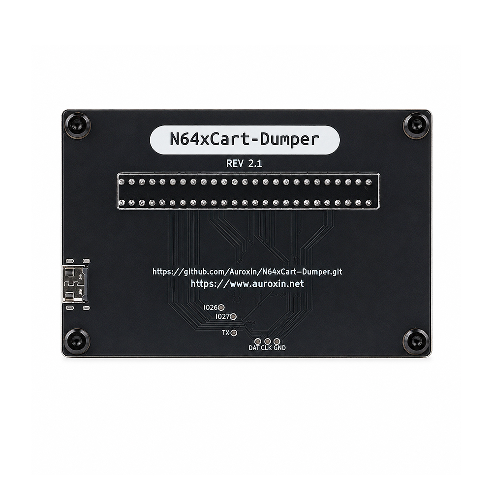

# N64xCart Dumper

N64xCart Dumper is a source-available hardware / firmware project for dumping Nintendo 64 cartridges as a USB mass storage device. It is based on the excellent DreamDumper64 project and the `DrmDmp64_mass` firmware, with changes for the N64xCart Dumper hardware.

<p align="center">
  
</p>

## Project Status

This repository contains:

- `firmware/N64xCartDumper/` - RP2040 firmware adapted for the N64xCart Dumper board.
- `hardware-v2.1/` - current and recommended KiCad and production files.
- `hardware-v1.1/` - legacy hardware files, retained for reference only.
- `extras/` - extra project files, if any.

The device appears to the computer as a USB mass storage device. The virtual FAT16 disk exposes N64 cartridge data and save data files such as ROM, EEPROM, SRAM and FlashRAM where supported by the firmware.

## Origin and Credits

This project exists because of prior open source work. Please visit and support the original authors:

- DreamDumper64 hardware project by khill25: https://github.com/khill25/Dreamdumper
- `DrmDmp64_mass` firmware by nopjne: https://github.com/nopjne/drmdmp64_mass
- Special thanks to [selunders](https://github.com/selunders/N64xCart-Dumper/tree/read_eeprom) for identifying the hardware v1.1 issues affecting CIC information and EEPROM reading, and for providing a detailed repair proposal that helped guide the updated hardware design.
- TinyUSB USB stack: https://github.com/hathach/tinyusb
- Raspberry Pi Pico / RP2040 SDK ecosystem: https://github.com/raspberrypi/pico-sdk

My changes are focused on adapting the firmware and hardware layout for the N64xCart Dumper board, including the PCB layout, production files, and acrylic enclosure design.


## Hardware

The hardware in this repository was redrawn and laid out for the N64xCart Dumper form factor while following the DreamDumper64 hardware principles.

> [!IMPORTANT]
> **Use hardware v2.1 for all new DIY builds. Do not build hardware v1.1.** Version 1.1 does not support reading CIC chip information from N64 cartridges or reading EEPROM save data. Hardware v2.1 resolves these limitations and is expected to be the final hardware revision. The v1.1 files remain in this repository for historical reference only.

<p align="center">
  
  <br>
  <sub><strong>N64xCart Dumper v2.1 — Rear view</strong></sub>
</p>

Current, recommended hardware files:

- KiCad project: `hardware-v2.1/PCB/N64xCartDumper-v2.1.kicad_pro`
- Schematic: `hardware-v2.1/PCB/N64xCartDumper-v2.1.kicad_sch`
- PCB layout: `hardware-v2.1/PCB/N64xCartDumper-v2.1.kicad_pcb`
- Production archive: `hardware-v2.1/production/N64xCart-Dumper-v2.1-20260813.zip`

Legacy v1.1 files are under `hardware-v1.1/` and are not recommended for manufacturing.

## Firmware

The firmware is based on `DrmDmp64_mass`, a mass storage device firmware for DreamDumper64. It has been modified for the N64xCart Dumper hardware.

Important local changes include:

- USB product strings changed to `N64xCart Dumper`.
- Hardware pin and LED configuration adapted for this board.
- Virtual disk label/product information updated for N64xCart Dumper.
- Project files arranged under `firmware/N64xCartDumper/`.

## Building Firmware

The active firmware build entry is the CMake project in `firmware/N64xCartDumper/`.

Typical build flow:

```sh
cd firmware/N64xCartDumper
mkdir build
cd build
cmake ..
cmake --build .
(optional) put pico in bootloader mode and copy the N64xCartDumper.uf2 to the attached drive.
```

You will need a working Raspberry Pi Pico / RP2040 build environment, including the Pico SDK, CMake, a supported ARM GCC toolchain, and the TinyUSB dependencies used by this project.

Note: the included `Makefile` appears to be inherited from an earlier TinyUSB example layout and may not match the current source file names. Prefer the CMake build unless you intentionally update the Makefile.

## Buying a Finished Unit

I also sell assembled N64xCart Dumper units on AliExpress. Units sold through the product link below use the latest v2.1 hardware. Buying one helps support the time spent on PCB layout, testing, assembly, enclosure design, and continued project maintenance.

- Support Us: [Product Link](https://www.aliexpress.com/item/1005012654363194.html)

Thank you for supporting this project. If you build your own non-commercial unit, improve the design, or find a bug, contributions and feedback are welcome.

## License Notes

The original N64xCart Dumper hardware designs, documentation, and project-specific modifications are licensed for **personal and other non-commercial use only** under the terms in [`LICENSE`](LICENSE). Commercial use—including manufacturing or selling boards, assembled units, kits, or derivative products—is prohibited without prior written permission from the applicable copyright holder.

This non-commercial restriction means the project is source-available, but it is not Open Source Hardware or open-source software under the commonly accepted OSI/OSHWA definitions.

This repository also contains code and design work derived from third-party projects. The project-level license does not replace or restrict third-party rights. Check the original projects, file headers, and bundled license files for the terms that apply to those materials:

- `DrmDmp64_mass`: https://github.com/nopjne/drmdmp64_mass
- DreamDumper64: https://github.com/khill25/Dreamdumper
- TinyUSB license file included at `firmware/N64xCartDumper/external/tinyusb/LICENSE`

Source files inherited from `DrmDmp64_mass` include their original copyright notices and headers. Third-party components remain the property of their respective copyright holders and are governed by their respective terms.

## Disclaimer

This is an independent hobbyist/source-available hardware project. It is not affiliated with or endorsed by Nintendo. Use it only with cartridges and data you legally own and are allowed to back up under your local laws.
